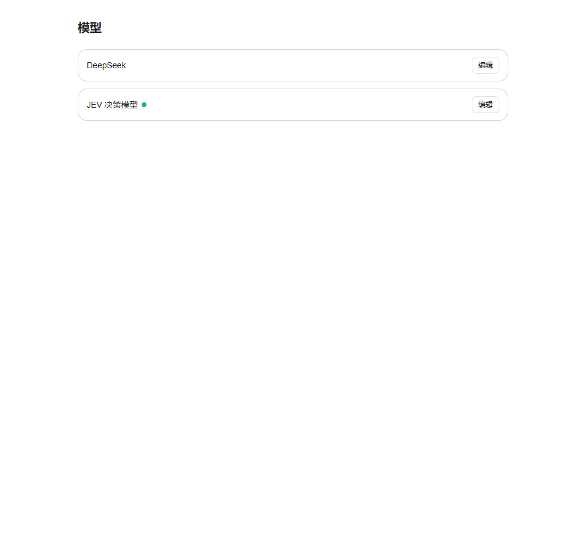
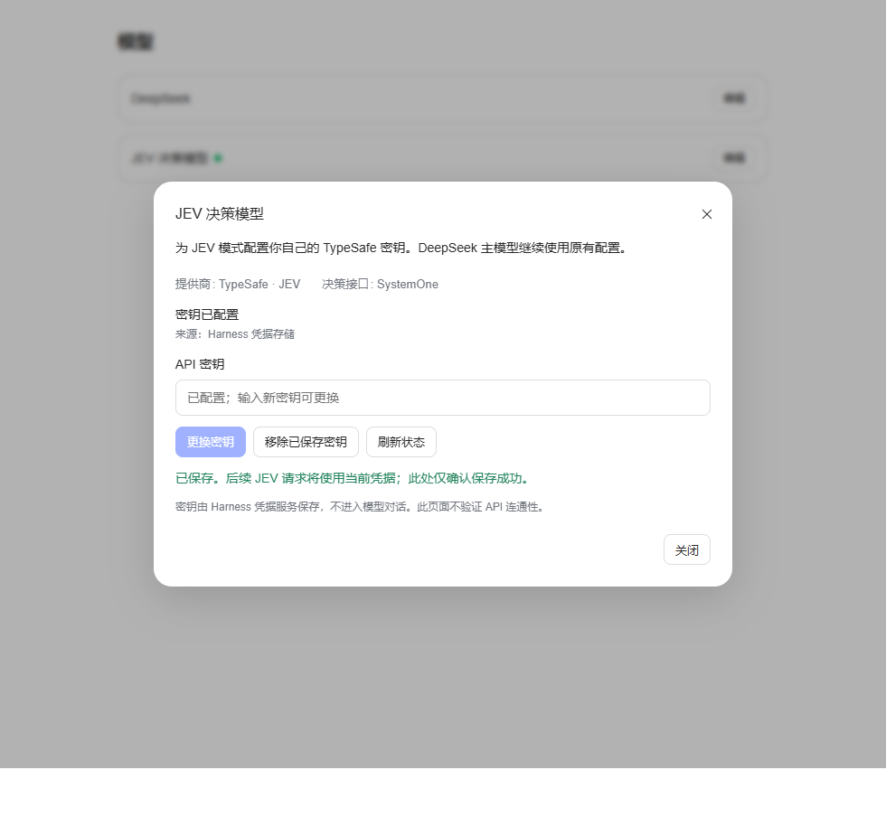

# JEV decision mode for DeepSeek Harness

> Local development is **0.4.7 candidate / Desktop 0.2.2-rc.5**, not pushed or publicly released. Read [HANDOFF.zh.md](HANDOFF.zh.md) before continuing. The documentation below describes public 0.4.6 for rc.3; use the local candidate for rc.5.

[中文](README.zh.md) · [Releases](https://github.com/QI-seven33/dsh-jev-mode/releases) · [Validation](VALIDATION.md) · [Issues](https://github.com/QI-seven33/dsh-jev-mode/issues)

An **unofficial, optional Desktop preset** maintained by QI-seven33. It retains the standard capability composition from DeepSeek Harness Desktop **0.2.2-rc.3** and adds limited project-file reads and a JEV authorization check. Your main-model configuration stays in use; the standard preset is unchanged.

**There is no established general speed or safety improvement.** Experiments have not shown a consistent benefit for everyday agent tasks. The classifier has known gaps; real-world authorization false-allow/false-block rates remain unmeasured.

## Installation

In Harness Desktop's **Plugins** page, install and enable:

```text
github:QI-seven33/dsh-jev-mode#v0.4.6
```

Alternatively, download [dsh-jev-mode-0.4.6.tgz](https://github.com/QI-seven33/dsh-jev-mode/releases/download/v0.4.6/dsh-jev-mode-0.4.6.tgz) and enter its absolute local path. Version 0.4.6 includes the unpublished 0.4.5 compatibility work and fixes its linked-workspace proxy-module failure. Public v0.4.4 is retained for the old Desktop 0.2.0-rc.2 host. The source ZIP is not a plugin package.

Fully restart Harness and select **JEV decision mode** in a new session. Open **Settings → Models → JEV decision model → Edit** to save your own TypeSafe API key. Keep your existing DeepSeek main-model settings. The credential dot means configured, not API connectivity verified.

No runtime dependencies or build/install lifecycle scripts are required. Verified environment: **Desktop 0.2.2-rc.3 on Windows**. Other versions and operating systems need separate validation. See [installation details](INSTALL.zh.md) and [acceptance steps](ACCEPTANCE.zh.md).

## Shipped behavior

| Request or operation | Behavior |
| --- | --- |
| Explicit query about root `package.json` or `README.md` | Code selects the file and uses native read/permissions; zero JEV selection calls. |
| Eligible short contrastive request between those two files | Bounded JEV selection. Confidence and selected probability must both reach 0.9; otherwise ordinary planning continues. |
| Operation classified at risk 2 or above | Hard rules run first, then JEV checks human authorization. Native permission vetoes remain authoritative. |
| Ordinary coding or document task | Standard planning and tools. No automatic skill selection, general preloading, or grounded/sufficient verification loop. |

`jev_status` reports the version and counters. `jev_decide` and `jev_gate` are available for explicitly requested diagnostics. A diagnostic result is not execution permission.

The default decision model is pinned to **`jev-1.13.0`**. Authorization uses **Noul**, thresholds **0.85 / 0.55**, and `gateAtRisk: 2`. Main-model history, reasoning and tool definitions are retained. Cache hits are best-effort, not guaranteed.

Without a TypeSafe key, explicit reads still work, semantic reads fall back, and unavailable authorization checks ask for approval or deny. Choose the standard preset to stop using the mode; disable the plugin in Plugins to remove its contribution.

## Deployment and compatibility work in 0.4.6

Resolve the public proxy module from the host-injected `profileContext.installAnchor`, rather than a bare import from the linked plugin workspace or an inferred ASAR path. Missing host transport produces a clear deployment error, no retry, zero HTTP requests and no provider-breaker failure.

Match the current native standard preset, replace removed module exports and single-tool dispatch, and follow the current working directory. Model, thresholds and permission ownership stay unchanged. A complete restart and a new session are required for Desktop acceptance.

JEV HTTP requests honor Harness launch proxy settings first. On Windows without explicit proxy settings, they read the enabled manual HTTP(S) system proxy automatically. Clash may stay in rule mode; Global mode, TUN and global environment edits are not required. Your proxy rules still decide the route. The adapter affects only JEV requests and never retries a failed proxy request directly.

The packaged Electron/ASAR and linked installation were checked with the default loader. A separate five-channel live smoke on 2026-11-17 used the installed 0.4.6 code and native credentials: five valid responses, 246–559ms, zero retries, rule mode and TUN off. These are connectivity observations, not speed or safety-quality evidence; see Validation. Each user still needs a key and a reachable service route. PAC/WPAD and SOCKS-only system proxies are unsupported; unavailable services return degraded results.

## What changes in 0.4.4

This is a **reliability release**: deadline-aware `Retry-After` handling, instance-local server cooldown, bounded credential lookup, and an auxiliary cancellation-signal repair. User cancellation does not count as a provider failure. It retains the compact settings card and native edit dialog from 0.4.3; the maintainer reported that UI working normally.

The experimental `/jev-json-set` transaction plugin is **not included**. Its narrow benchmark gains do not describe this release. See the [changelog](CHANGELOG.md) and [validation](VALIDATION.md) for exact coverage, skips and measurement limits.

## Security and data flow

- The gate supplements native permissions; it cannot replace the sandbox or grant extra rights. Variants such as `npm --prefix subproject publish` and `git -C subproject push` can miss the JEV gate. A low risk label does not prove safety or authorization.
- Semantic checks send bounded context to TypeSafe, such as the relevant request or human authorization history and proposed action. Redaction is best-effort; do not put secrets in prompts or command arguments. Calls may incur separate charges.
- Keys use Harness's credentials service. Saved values are not returned to the browser or model conversation. No shared key is shipped. Environment credentials are read-only; removing a stored key may expose an existing environment fallback.
- The local ledger stores metadata and hashes, not command bodies, decision-reason bodies or credentials.

## Settings and UI

Defaults include `controlledFlow: true`, `semanticReads: true`, `autoGate: true`, `onGateFailure: escalate`, and `statusContext: false`. Set `semanticReads: false` in the mode configuration to use ordinary planning for ambiguous reads. Restart and open a new session after changing preset configuration.

<details>
<summary>Settings UI previews</summary>

Component-test previews using host React/Modal and a stubbed credentials remote; not an authenticated Desktop session.

<p></p>
<p></p>

</details>

## Development and support

```sh
npm install --no-save --no-package-lock yaml@2
npm test
```

CI runs offline checks on Node 20/22/24. Native checks require Node 24 and host paths via `DSH_HOST_NODE_MODULES` / `DSH_HOST_NATIVE_NODE_MODULES`; absent-host skips are not compatibility evidence. Live API checks are opt-in.

For issues, include plugin/host versions, OS, new-session status and minimal reproduction steps. Remove credentials and sensitive content from logs. New feature research is closed; no additional JEV involvement in ordinary tasks is planned.

[Source attribution](PROVENANCE.md) · [Release procedure](RELEASING.md) · [MIT License](LICENSE)
