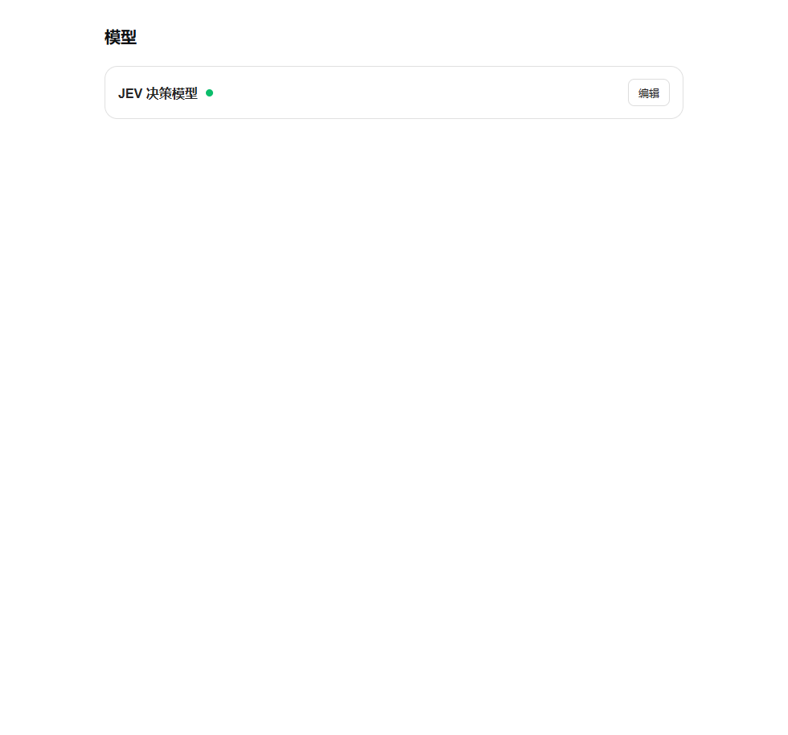
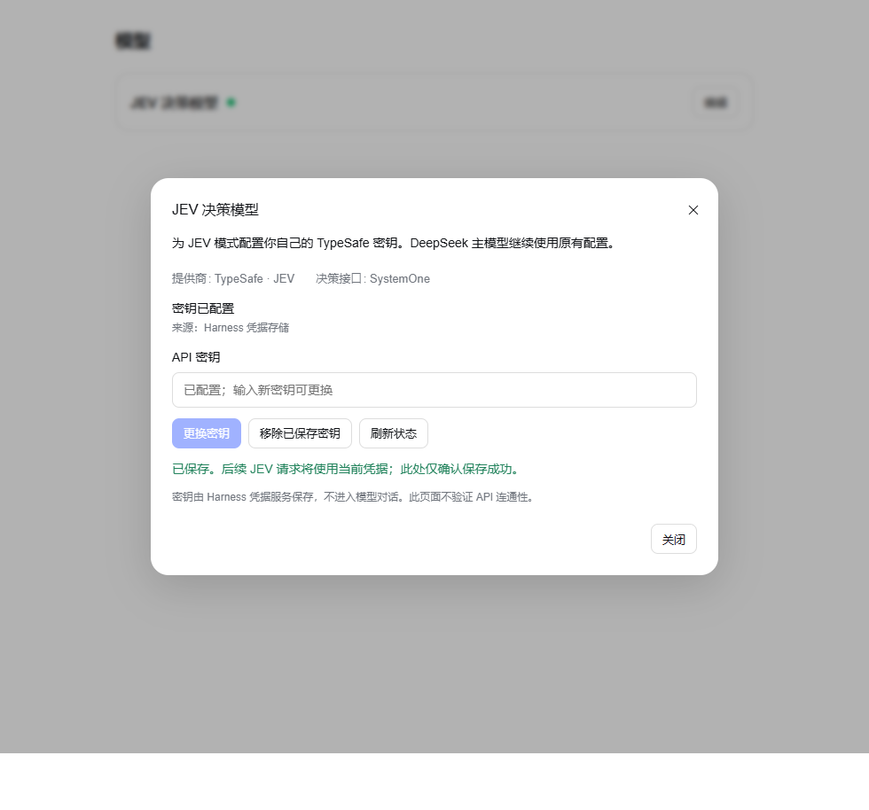

# DeepSeek Harness 桌面版 JEV 决策模式

由 QI-seven33 独立开发和维护的非官方社区插件。[English](README.md) · [安装包](https://github.com/QI-seven33/dsh-jev-mode/releases/tag/v0.4.2)

上图为实际宿主 React/Modal 组件测试预览，凭据远端使用测试桩，不是已登录桌面会话截图。

0.4.2 在标准模式中增加按需语义判断。明确事情由代码处理，语义判断只在受控边界内补充。它不修改标准预设。

0.4.2 只新增模型设置页的凭据卡片及加载入口拆分；决策实现沿用 0.4.0。本次验证凭据读写、浏览器交互和原生回归，没有重新测量速度或安全准确率。

## 做了什么

- 明确项目查询：代码选择根目录 package.json 或 README.md，经原生 read 和权限管线读取，不调用 JEV。
- 有限歧义查询：只对短、只读、具有显式取舍语义且两个固定文件均可用的请求调用 JEV；有效返回且置信度/所选概率均至少 0.9 才执行固定读取。低置信度、缺少凭据或超时回退普通规划。
- 危险授权闸门：硬规则先处理；风险 2+ 的剩余操作检查宿主中的真实用户指令历史。阈值仍为 0.85 / 0.55，尚未进行领域校准。结果不覆盖宿主权限或其他插件的拒绝。
- 普通代码/文档任务走标准工具。写入正文中的命令引用不参与执行风险分类。不自动调用 route、risk、grounded 或 sufficient，也没有自动验证闭环。
- 固定系统提示和完整工具目录，每会话只注册一次；检查结果以支持 V4 持久化的 producer-owned 通知追加至历史。默认不向主模型注入状态计数。
- jev_status 显示版本、代码/JEV 尝试、回退、证据复用及耗时；台账只存元数据和哈希，不存动作正文、理由正文或密钥。

## 安装与更新

面向其他用户的安装、启用与密钥录入步骤见 [INSTALL.zh.md](./INSTALL.zh.md)。在插件安装入口输入 `github:QI-seven33/dsh-jev-mode#v0.4.2` 并启用；也可安装 [Release 的 .tgz 附件](https://github.com/QI-seven33/dsh-jev-mode/releases/tag/v0.4.2)。仅克隆仓库不会自动加载插件。

桌面版通过应用内插件入口安装本包的目录或发布后的包；桌面 profile 由 Electron 管理，请勿直接套用 CLI profile 的安装命令。
更新后需完全退出桌面版并重开，在新会话选择「JEV 决策模式」。
只支持已核对的 DSH 0.2.0-rc.2 标准预设组合；宿主更新后应重新核对组合和原生契约。

打开「设置 → 模型」，滚动到页面底部的「JEV 决策模型」卡片，点击卡片右侧「编辑」，在弹窗里输入自己的 TypeSafe API 密钥并点击「保存密钥」。不需要在「自定义模型 API」里新增聊天模型。卡片支持更换、移除和刷新状态；只显示是否已配置，不回显保存的密钥，也不测试连通性。

密钥通过宿主 credentials 服务写入 TYPESAFE_API_KEY 引用。保存后后续 JEV 请求读取新凭据，无需因密钥变更重启。启动环境提供的密钥为只读；.env 的旧密钥可被凭据存储覆盖，移除已保存密钥后可能恢复 .env 来源。不要把值写进源码、提交或发布材料。

安装入口分成全局 settings.js（只使设置卡片可发现）和预设内 dsh-jev-mode/mode（原 index.js 的决策功能）。手动配置旧插件行时应将名称更新为 dsh-jev-mode/mode；通过本包补丁安装会自动采用新名称。
桌面预设固定 backend: typesafe。缺少凭据时明确读取照常，语义读取回退，危险判断失败进入审批或拒绝。
没有运行时依赖；yaml 是测试用开发依赖。

## 设置

修改预设中的插件 config 后重启应用并开新会话：

| 配置 | 桌面默认 | 用途 |
| --- | --- | --- |
| controlledFlow | true | 开启有限前置原生读取 |
| semanticReads | true | 歧义读取是否调用 JEV；false 为代码优先且歧义回退 |
| autoRoute | false | 保留旧版显式调试选项，默认关闭 |
| autoGate / gateAtRisk | true / 2 | 独立危险授权闸门 |
| protocol | focused | 收紧自动决策提示；full/compact 仅为旧版兼容 |
| statusContext | false | 状态默认只通过 jev_status 查看 |
| onGateFailure | escalate | ask；deny 可选。旧 allow 值会迁移为 escalate |
| ledger | true | 元数据台账；false 仅保留进程内计数 |

预设是可选模式。关掉插件不会关闭宿主权限策略。显式诊断工具仍可应用户请求调用，不应把诊断结果当成实际执行许可。

## 验证与证据边界

运行 npm test：参数/输出原生 schema、固定提示、授权来源、引用误拦、传输失败、原生读取和 V4 none/zstd 持久化等。
原生回归要求 Node 24 及已安装宿主。其他机器通过 DSH_HOST_NODE_MODULES / DSH_HOST_NATIVE_NODE_MODULES 指定宿主路径。CI 中允许缺失宿主时跳过，跳过不是桌面兼容性证明。
基准脚本只有带 --live 才请求真实服务，主模型与 JEV 用量分开统计。详细设置见 bench/COMPARE.md。

之前的三组实验支持明确读取优先使用代码。随后 0.4.0 混合流程的标准模式对照包含 56 次执行，两组各 28/28 成功，中位耗时下降但 JEV 模式 P95 恶化。决策实现沿用至本版；这些小样本不证明全面提速或安全准确率提升。具体数据与边界见 [VALIDATION.md](./VALIDATION.md)。
本版控制流通过离线和原生回归验证；其他环境仍需要用户验收。网络抖动和回退仍可能增加总耗时，不保证更快或固定缓存命中率。

开始验收请阅读 [ACCEPTANCE.zh.md](./ACCEPTANCE.zh.md)。发布步骤见 [RELEASING.md](./RELEASING.md)。
